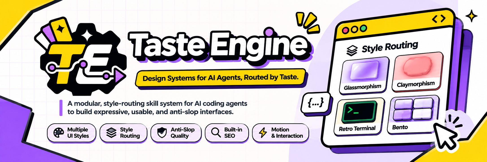

<div align="center">

<p align="center">
  
</p>

# Taste Engine

**The design skill that starts with your taste, not the model's defaults.**

A portable, open-source Agent Skill for building distinctive, accessible frontends with user-selected visual styles, anti-slop quality gates, SEO guidance, and purposeful motion.

[](LICENSE)
[](CHANGELOG.md)
[](https://agentskills.io/)

[Installation](#install) · [How it works](#how-it-works) · [Styles](#style-library) · [Quality principles](#quality-without-a-house-style) · [Contributing](#contributing)

</div>

## Why Taste Engine?

Most AI-generated interfaces look familiar because the agent chooses a visual direction without asking. Taste Engine changes the order of operations: **discover the user's preference, load exactly the relevant design guidance, implement, and review.**

**No house aesthetic. No default purple gradient. No mandatory framework.** Claymorphism, brutalism, minimalism, glassmorphism, and other styles are equal first-class choices.

## Install

### Recommended: Agent Skills CLI

Requires Node.js and access to GitHub. The repository exposes a standard `skills/taste-engine/SKILL.md` package, so the portable [`skills` CLI](https://github.com/vercel-labs/skills) can discover and install it.

```bash
# Interactive: select an agent and installation scope
npx skills add kennedys0/taste-engine --skill taste-engine

# Install globally for Claude Code
npx skills add kennedys0/taste-engine --skill taste-engine -a claude-code -g -y

# Install globally for Codex
npx skills add kennedys0/taste-engine --skill taste-engine -a codex -g -y

# Install for Antigravity
npx skills add kennedys0/taste-engine --skill taste-engine -a antigravity -g -y

# Install for the Antigravity CLI
npx skills add kennedys0/taste-engine --skill taste-engine -a antigravity-cli -g -y
```

**Antigravity IDE note:** The `skills` CLI may install to a backward-compatible Antigravity path. For the exact current Antigravity IDE global location (`~/.gemini/config/skills/`), use the native installer below. See [the official Antigravity locations](https://antigravity.google/docs/skills).

### Native CLI: exact agent paths, no dependencies

Clone the repository and run the bundled Node.js CLI (Node 20+):

```bash
git clone https://github.com/kennedys0/taste-engine.git
cd taste-engine

# Exact Antigravity IDE global location
node bin/taste-engine.mjs install --agent antigravity --global

# All supported agents in the current project
node bin/taste-engine.mjs install --agent all --project

# Check an installation
node bin/taste-engine.mjs doctor --agent antigravity --global
```

The installer supports `antigravity`, `antigravity-cli` (alias `agy`), `claude-code` (alias `claude`), `codex`, or `all`. It backs up an existing Taste Engine directory before replacing it and refuses to overwrite an unrelated skill. See [INSTALL.md](INSTALL.md) for paths and update options.

> **Publication status:** installation commands work after the source files in this repository are published. The presence of a GitHub repository alone does not imply a working skill package or a release asset.

## How it works

| Your request | Taste Engine behavior |
| --- | --- |
| “Build a portfolio website.” | Ask one question: which visual style? Pause before writing UI code. |
| “Build a skeuomorphic portfolio.” | Load the Skeuomorphism pack and implement immediately. |
| “Build a glassmorphism landing page in Next.js.” | Load Glassmorphism, web quality checks, React performance, and public SEO. |
| “Fix the mobile navbar in this project.” | Preserve the existing design system; do not repeat the style question. |
| “Audit the SEO of my website.” | Run the SEO guidance only; do not introduce a style picker. |

The agent's host controls automatic skill discovery. Taste Engine provides a precise `name`/`description` trigger, but does not claim guaranteed invocation across all agents or IDE versions.

<details>
<summary><strong>Example style question</strong></summary>

> Before I start designing, which direction would you prefer: Claymorphism, Glassmorphism, Brutalism, Neo-brutalism, Minimalism, Swiss/Editorial, or something custom? You can also share a reference image.

</details>

## Style library

| Style | Visual character |
| --- | --- |
| **Claymorphism** | Sculpted, tactile surfaces and soft dimensional depth |
| **Glassmorphism** | Controlled translucency, layering, and readable glass surfaces |
| **Brutalism** | Direct typography, raw grid structures, intentionally hard edges |
| **Neo-brutalism** | Playful contrast, solid borders, and purposeful hard shadows |
| **Minimalism** | Quiet composition, clarity, and efficient visual hierarchy |
| **Swiss / Editorial** | Typographic rhythm, rigorous grids, and editorial composition |
| **Bento** | Deliberate modular layout and varying visual weight |
| **Skeuomorphism** | Physical metaphors, materials, and tactile controls |
| **Retro Terminal** | Console-inspired typographic systems with functional restraint |
| **Enterprise / Data-first** | Readable density, operational states, and repeat-use efficiency |

A `custom` design direction is always allowed. Styles do not dictate page sections: the product's goals, content, and audience determine the page anatomy.

## Quality without a house style

Taste Engine separates user taste from non-negotiable engineering quality:

- **Anti-slop:** No decorative card-inside-card stacks, fabricated metrics, generic marketing filler, pointless animations, or unrelated charts. A style's characteristic blur, depth, or hard shadow is allowed when functional and intentional.
- **Accessibility:** Semantic HTML, keyboard operation, focus feedback, responsive layout, and reduced-motion alternatives.
- **Public-site SEO:** Truthful metadata, heading structure, indexability checks, internal links, and performance guidance. Never invent a canonical URL or structured data.
- **Full-viewport hero:** New public portfolios and landing pages use a mobile-safe first-screen composition when a hero is appropriate, while respecting explicit instructions for shorter/no heroes.
- **Purposeful motion:** CSS and native APIs first; Anime.js v4 only when interaction complexity justifies it. No default animation dependency.
- **Conditional engineering:** React/Next.js, React Native/Expo, and view-transition guidance load only where applicable. Vue, Svelte, and Astro are not forced into React conventions.

Read the [core skill](taste-engine/SKILL.md), [quality gates](taste-engine/references/quality-tiers.md), [SEO guide](taste-engine/references/seo.md), and [motion engine guide](taste-engine/references/motion-engine.md).

## Repository structure

```text
.
├── taste-engine/             # Canonical skill, references, styles, validation
│   ├── SKILL.md
│   ├── styles/               # 10 independent aesthetic packs
│   ├── references/           # SEO, anti-slop, motion, accessibility, engineering
│   ├── scripts/              # Validator, style probe, SEO auditor, updater
│   └── tests/                # Unit tests and agent evaluation scenarios
├── skills/taste-engine/      # Generated mirror for npx skills discovery
├── optional-standalone-skills/
├── bin/taste-engine.mjs      # Native multi-agent installation CLI
├── scripts/                 # Mirror sync, release build
└── .github/workflows/       # Validation and versioned releases
```

The canonical source is `taste-engine/`. Contributors should edit that directory, then run `python3 scripts/sync-agent-skills.py` to regenerate the discovery mirror.

## Development and verification

```bash
python3 scripts/sync-agent-skills.py --check
python3 taste-engine/scripts/validate-pack.py
python3 -m unittest discover -s taste-engine/tests -p 'test_*.py'
node --test tests/cli.test.mjs
python3 scripts/build-release.py
```

The tests verify file structure, routing data, and helper scripts. They are **not a substitute for browser testing** or an empirical guarantee that a coding agent will obey every instruction.

## Updates and releases

For installs managed by the [`skills` CLI](https://github.com/vercel-labs/skills):

```bash
npx skills check
npx skills update -g
```

For the bundled Antigravity updater, once an official GitHub Release exists:

```bash
bash ~/.gemini/config/skills/taste-engine/scripts/update.sh --repo kennedys0/taste-engine
```

Releases are built from tags and include an updater-compatible ZIP. See [INSTALL.md](INSTALL.md) and [CHANGELOG.md](CHANGELOG.md).

## Contributing

Issues, new style proposals, accessibility improvements, translations of optional examples, and evaluation cases are welcome. Contributions must not impose a visual aesthetic on other users. Start with [CONTRIBUTING.md](CONTRIBUTING.md) and follow the [Code of Conduct](CODE_OF_CONDUCT.md) when contributing.

## Sources and attribution

Original implementation, with documented research from [Anti-Slop Design](https://github.com/Ferousco-dev/anti-slop-design), [Hallmark](https://github.com/Nutlope/hallmark), [Anti-AI-Slop Writing](https://github.com/jalaalrd/anti-ai-slop-writing), [Taste Skill](https://github.com/tasteskill/tasteskill), and [Vercel Agent Skills](https://github.com/vercel-labs/agent-skills). This project is independent of those repositories and does not claim endorsement. See [research notes](taste-engine/references/research-notes.md).

**License:** [MIT](LICENSE). © 2026 Taste Engine contributors.
