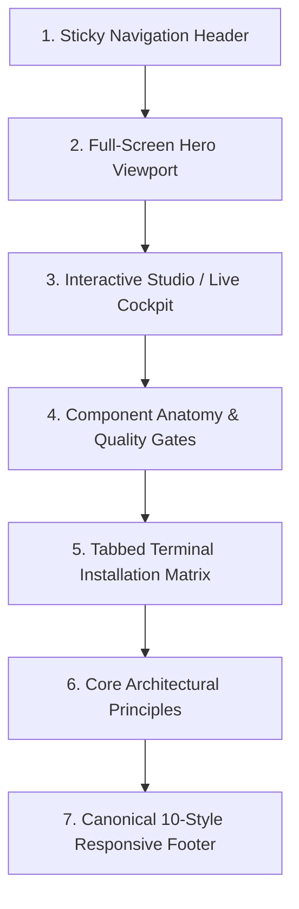

# Proof-of-Work (PoW) Showcase Architectural Contract & Preset Standard

**Scope:** Canonical architectural blueprint, section hierarchy, responsive invariants, and interaction contracts for Taste Engine Proof-of-Work (PoW) showcase pages (such as `docs/*.html`). This standard prevents layout drift, UI regression, button misalignment, and mobile truncation across all aesthetic showcase pages.

---

## 1. The 7 Canonical Showcase Sections (Invariant Order)

Every Taste Engine PoW showcase page must implement the following 7 sections in strict sequential order:

1. **Sticky Navigation Header (`<header class="pow-header">` / `<nav>`):**
   - Brand logo and icon sourced from `assets/logo.webp` (with `width: 24px; height: 24px; aspect-ratio: 1 / 1; flex-shrink: 0; object-fit: contain;`) paired with version badge (e.g., `v0.12.0` / `v0.13.1`).
   - Page favicon declared in `<head>` via `<link rel="icon" type="image/webp" href="assets/logo.webp">`.
   - Symmetrical desktop action buttons (`36px` uniform height).
   - Theme toggle (light/dark switch) with centered SVG icon.
   - Mobile hamburger drawer trigger (`< 768px`) with accessible sliding drawer containing style selector links.
2. **Full 1-Screen Hero Viewport (`<section class="pow-hero">`):**
   - **Full 1-Screen Height Contract:** Must declare `min-height: calc(100vh - var(--pow-header-h, 58px)); min-height: calc(100svh - var(--pow-header-h, 58px)); display: flex; flex-direction: column; justify-content: center;` (with `--pow-header-h` defined in `:root`) so `header + hero` occupies 1 full opening screen (`100%` of the first viewport at `1440×900` / `1440×950`) with zero bleed from Section 3 below.
   - Identity badge / pill strip grounded in the style's material domain (no self-congratulatory QA boast pills).
   - Primary title with fluid typography clamp (`clamp(2rem, 3.8vw, 3.15rem)` desktop, `clamp(1.5rem, 6.2vw, 2rem)` mobile).
   - Concise, human-centered architectural subtitle explaining the aesthetic's core purpose.
   - Compact single-row hero command box (`height: 42px–44px`, `flex-wrap: nowrap`, `border-radius: 10px`) with horizontally scrollable `<code>` region (`min-width: 0; overflow-x: auto; white-space: nowrap;`) and a flex-protected `[Copy]` button (`flex-shrink: 0`) that never wraps into a tall multi-line capsule on mobile.
   - Primary and secondary CTA action links (`40px–44px` height) paired with a balanced material centerpiece (`align-items: center`) and bottom dock/telemetry strip.
3. **Interactive Studio / Live Cockpit (`<section class="pow-studio">`):**
   - The primary proof-of-work demonstration (e.g., Pixel Studio, Data Cockpit, Canvas Editor).
   - Window title bar with controls (macOS window dots or retro maximize/close buttons).
   - Responsive layout with `max-width: 100%`, `overflow-x: auto;`, and touch containment so it never gets clipped in half on mobile viewports.
   - Live interactive tools, status feedback, and action drawer/modals.
4. **Component Anatomy & Strict Style Gates (`<section class="pow-components">`):**
   - Real, functional component specimens illustrating the aesthetic (cards, badges, inputs, toggles, tables, alerts).
   - Strict style-specific quality gate cards highlighting what is enforced and what fails the gate.
5. **Tabbed Terminal Installation Matrix (`<section class="pow-install">`):**
   - Interactive 3-tab terminal replacing cramped, narrow cards:
     - `01: STANDALONE SKILL` (dedicated style pack)
     - `02: FULL TASTE ENGINE` (universal 10-style autonomous suite)
     - `03: TAILWIND & SHADCN PRESETS` (code tokens & scaffolding)
   - Window header with window dots, terminal label, and dedicated right-aligned `Copy Command` button.
   - Zero text overlap: copy button is permanently segregated into the window header.
   - Agent support strip at the bottom (`Antigravity`, `Claude Code`, `Cursor`, `Codex`, `Windsurf`, `Cline`, `GitHub Copilot`).
6. **Core Architectural Principles (`<section class="pow-principles">`):**
   - 3 fundamental pillars of the aesthetic system (e.g., purposeful restraint, strict grid alignment, honest data density).
7. **Canonical 10-Style Responsive Footer (`<footer class="pow-footer">`):**
   - Responsive multi-column grid (`repeat(auto-fit, minmax(200px, 1fr))`) — never stretched into a single tall column on desktop.
   - Directory linking all 10 canonical Taste Engine styles (`Minimalism`, `Retro-Pixel`, `Claymorphism`, `Frutiger Aero`, `Neo-Brutalism`, `Art Deco`, `Swiss Editorial`, `Brutalism`, `Retro-Terminal`, `Y2K Futurism`).
   - Brand column including `assets/logo.webp` alongside copyright, Agent Skills CLI reference, and MIT license.

---

## 2. Invariant Rules & Anti-Regression Invariants

### Invariant A: Navigation Button Height & Geometry Uniformity
- All paired interactive buttons in headers must declare identical height (`height: 36px` or `2.25rem`), identical `box-sizing: border-box`, `display: inline-flex`, `align-items: center`, and `justify-content: center`.
- Icon-only buttons (Theme Toggle, Hamburger Menu) must declare `aspect-ratio: 1 / 1; width: 36px; height: 36px; padding: 0;` with centered SVG icons.
- Never mix raw tag defaults (`<a>` padding vs `<button>` margin) or unconstrained text that causes mismatched button heights.

### Invariant B: Mobile Header & Hamburger Drawer (< 768px)
- On screens narrower than `768px`, desktop navigation links and "All Styles" dropdowns must be hidden (`display: none;`) from the top bar.
- The top bar must only display: Brand Logo + Theme Toggle + Hamburger Menu Button.
- The Hamburger Menu opens an accessible side drawer or full-screen overlay containing the complete list of 10 Taste Engine styles and links.
- Heading and logo text must use fluid typography (e.g. `clamp(0.85rem, 2.5vw, 1.05rem)`) to prevent header wrapping on narrow 320px mobile viewports.

### Invariant C: Interactive Studio Responsive Containment
- The interactive studio container must never be clipped horizontally on mobile.
- Enforce `max-width: 100%`, `overflow-x: auto`, and `-webkit-overflow-scrolling: touch;`.
- Canvas, workstation tools, and preview boards must support fluid resizing or horizontal touch scrolling with visible indicators.

### Invariant D: Tabbed Terminal Installation (Zero Button Overlap)
- Never use a 3-card horizontal grid where 60-character CLI commands are squeezed into < 280px containers.
- The Installation section must use a unified tabbed terminal card (`.tabbed-terminal-card`).
- The Copy button must reside in the `.terminal-header`, on the opposite side of the terminal dots. It must never float on top of or overlap the code text.
- Terminal code blocks must support syntax styling with `#` comments and `$` prompts.

### Invariant E: Responsive 10-Style Footer Grid
- The footer links section must use `grid-template-columns: repeat(auto-fit, minmax(200px, 1fr))` with `max-width: 1200px; margin: 0 auto;`.
- Do not let the footer stretch into a single full-width column on wide desktop monitors.
- Exactly 10 canonical styles must be represented:
  1. Minimalism & Data Cockpit
  2. Retro-Pixel & 8-Bit
  3. Claymorphism
  4. Frutiger Aero (Classic, Glass, Tactile)
  5. Neo-Brutalism
  6. Art Deco (Modern, Classic, Minimal)
  7. Y2K Futurism (Chrome, Holographic, Retro Tech)
  8. Swiss Editorial
  9. Brutalism (Raw & Bento layout variants)
  10. Retro-Terminal CRT

### Invariant F: Asset Management (Logo & Brand Icon from Assets)
- Showcases MUST link and display canonical brand assets from the repository's `assets/` directory (`docs/assets/`):
  - **Favicon:** Every showcase declares `<link rel="icon" type="image/webp" href="assets/logo.webp">` in `<head>`.
  - **Header Brand Icon:** Brand lockup includes the official logo `` enforcing `width: 24px; height: 24px; aspect-ratio: 1 / 1; flex-shrink: 0; object-fit: contain;` alongside the text title.
  - **Drawer & Footer Brand Presence:** Mobile drawer header and site footer brand column utilize `assets/logo.webp` to anchor visual recognition.
  - **Workstation Fixtures:** When hardware illustrations or social preview cards are utilized, link `assets/computer.webp` or `assets/banner.webp` without broken relative paths.

### Invariant G: Balanced Card Stacks & Multi-Column Grid Symmetry
- **Split-Column Stack Stretch:** Whenever a 2-column Studio bay or Component Gallery places a single tall card in Column A alongside a vertical stack of 2 or 3 smaller cards in Column B, the parent grid MUST declare `align-items: stretch;`, the stacked column wrapper MUST declare `display: flex; flex-direction: column; height: 100%; justify-content: space-between;`, and each stacked child card MUST declare `flex: 1 1 0%; display: flex; flex-direction: column; justify-content: space-between;` so top and bottom edges of both columns align flush with zero empty void under the shorter column.
- **Equal-Height Peer Cards:** All multi-column card grids (`.pow-principles-grid`, `.y2k-balanced-grid-3`, `.y2k-balanced-grid-6`, `.y2k-diff-matrix`) MUST stretch cards to equal row height (`align-items: stretch; height: 100%;`) and pin bottom action/status bars via `margin-top: auto;`.
- **Zero Orphan Control Wrapping (`2×2` or `3×2` Symmetry):** Never wrap 4 checkboxes, radio buttons, or action buttons as `3` on Row 1 + `1` orphan on Row 2, and never place 3 cards in a 2-column tablet grid leaving 1 empty slot. Use `2×2` grids for 4 items and `3×2` / `2×3` (`6` cards) for multi-breakpoint card matrices.

### Invariant H: Full 1-Screen Hero Viewport & Single-Row Scrollable Command Well
- **Full 1-Screen Opening Viewport (`100svh`):** Every PoW showcase `.pow-hero` MUST fill 1 full screen (`min-height: calc(100vh - var(--pow-header-h, 58px)); min-height: calc(100svh - var(--pow-header-h, 58px)); display: flex; flex-direction: column; justify-content: center;`) with `--pow-header-h` defined in `:root`. The opening screen (`header + hero`) must be a complete, self-contained 1-screen composition at `1440×900` / `1440×950` without the next section peeking into the bottom of the first viewport.
- **Compact Single-Row Hero Command Box:** Never allow `.pow-hero-cmd` to use `flex-wrap: wrap` with `border-radius: 9999px` on mobile, which inflates long CLI commands into a giant multi-line stadium/egg capsule. Enforce `flex-wrap: nowrap; height: 42px–44px; border-radius: 10px;` with an inner scrollable code wrapper (`min-width: 0; overflow-x: auto; white-space: nowrap;`) and a pinned `[Copy]` button (`flex-shrink: 0; height: 32px;`).

---

## 3. CSS Preset Utility Mapping

Showcase pages should align with these standard CSS classes:

| Class Selector | Purpose | Invariant Contract |
|---|---|---|
| `.pow-header` | Top sticky bar | `position: sticky; top: 0; z-index: 100; backdrop-filter: blur(8px);` |
| `.pow-nav-btn` | Header action button | Uniform `height: 36px; display: inline-flex; align-items: center;` |
| `.pow-icon-btn` | Icon-only toggle | `width: 36px; height: 36px; aspect-ratio: 1/1;` |
| `.pow-drawer` | Mobile slide drawer | Displayed on `< 768px` when triggered by hamburger button |
| `.pow-hero` | Full 1-screen first viewport hero | `min-height: calc(100vh - var(--pow-header-h, 58px)); min-height: calc(100svh - var(--pow-header-h, 58px)); display: flex; flex-direction: column; justify-content: center;` |
| `.pow-hero-cmd` | Compact single-row hero copy snippet | `flex-wrap: nowrap; height: 44px; border-radius: 10px;` with `overflow-x: auto; white-space: nowrap; min-width: 0;` for `code` and `flex-shrink: 0;` for copy button |
| `.pow-studio` | Live demo workspace | Centered, `max-width: 100%; overflow-x: auto;` |
| `.pow-card` | Equal-height card container | `height: 100%; display: flex; flex-direction: column; justify-content: space-between;` |
| `.y2k-balanced-stack` | Split-column equal-height card stack | `display: flex; flex-direction: column; height: 100%;` with `flex: 1 1 0%` child cards |
| `.tabbed-terminal-card` | Installation terminal | 3 tabs, header dots, header copy button, agent matrix footer |
| `.pow-footer` | Showcase footer | Responsive auto-fit grid, 10 canonical style links |

